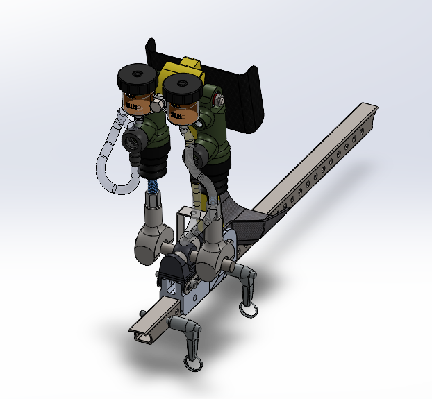

## Problem / Goal

Redesign the brake fluid reservoir for a Formula SAE vehicle to accommodate an inverted master cylinder configuration. The new design needed to resolve packaging constraints introduced by the inverted layout while maintaining SAE compliance and structural integrity under braking loads.

## Approach

The reservoir was modeled in SolidWorks around the inverted master cylinder's revised mounting orientation, working within the tighter packaging envelope this configuration created relative to the standard layout. Geometry was iterated to maintain adequate fluid capacity and mounting clearance while keeping the design compliant with SAE rules for brake system components.

Beyond the reservoir itself, 20+ critical drivetrain and brake pedal components were machined on a CNC mill and metal lathe, with a focus on removing unnecessary material wherever structural margins allowed.

## Model

## Outcome

The redesigned reservoir met packaging and SAE compliance requirements and shipped on the competition car. Across the manufactured parts, machining contributed to an overall weight reduction of 1 lb.
