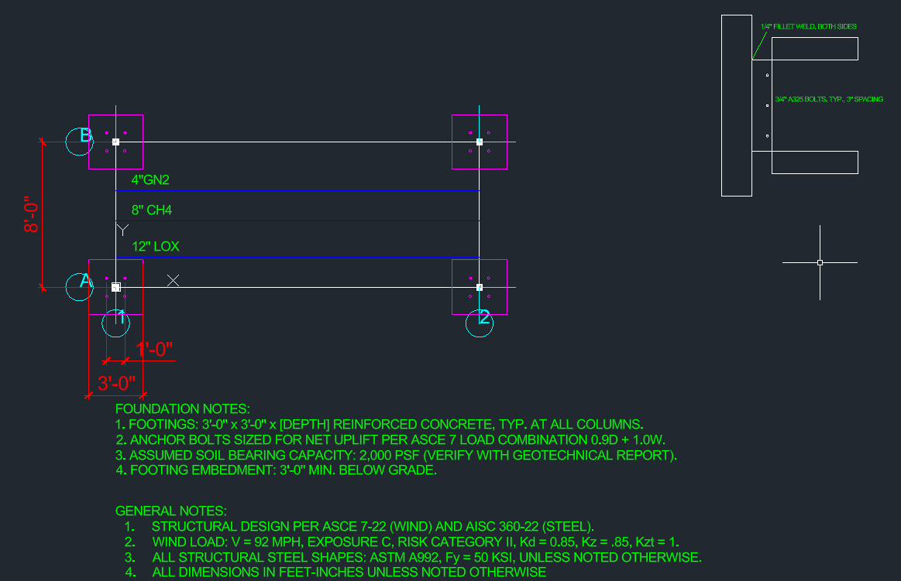

## Problem / Goal

Design a single-bay steel pipe rack to support cryogenic propellant transfer lines for a launch site application, carrying a 12" LOX line, an 8" CH4 line, and a 4" GN2 purge line. The rack needed to satisfy ASCE 7 load requirements and AISC steel design provisions while accommodating the thermal and mechanical demands of routing cryogenic fluid lines at height across a 20 ft bent spacing.

## Approach

The design began with establishing the bent geometry: an 8 ft transverse span between columns, a 12 ft clear column height, and 20 ft bent spacing along the rack. Three process lines were routed across the bent — a 12" LOX transfer line, an 8" CH4 transfer line, and a 4" GN2 purge line.

**Dead Load**

Dead load was calculated per line by summing pipe steel weight, contents weight, and an assumed insulation allowance:

| Line | Steel (lb/ft) | Contents (lb/ft) | Insulation (assumed) | Total (lb/ft) |
|---|---|---|---|---|
| 12" LOX | 53.57 | 55.38 | 5 | 113.95 |
| 8" CH4 | 28.58 | 9.93 | 3 | 41.51 |
| 4" GN2 | 10.8 | 0.95 | 2 | 13.75 |

Summing all three lines gives 169.21 lb/ft. A 20% allowance was added for fittings, supports, and miscellaneous attachments, bringing the total distributed dead load to 203.052 lb/ft. Multiplying by the 20 ft bent spacing gives a total dead load of 4,061.04 lb per bent.

**Live Load**

A 300 lb maintenance live load was applied at midspan to account for personnel access during inspection or servicing.

**Wind Load**

Wind load was calculated using ASCE 7 methodology:

qz = 0.00265 × 0.85 × 1 × 0.85 × 92² = 15.65 psf

Applied over a projected area of 40 ft² with a force coefficient (Cf) of 1.8, this produced a lateral wind force of:

15.65 × 40 × 1.8 = 1,126.8 lb per bent

**Load Combinations**

Governing load combinations were checked per ASCE 7:

- 1.2D + 1.6L = 1.2(4,061.04) + 1.6(300) = **5,353.248 lb**
- 1.2D + 1W + L = 5,353.248 + 1,126.8 = **6,480.048 lb**

The combined dead, live, and wind case governed the design, and this value was carried forward into member sizing for the bent.

## Standards & Codes

- ASCE 7 (loads)
- AISC steel design provisions

## Drawing

Drafted in AutoCAD as drawing **S-101 — "Cryogenic Transfer Pipe Rack"**, 1/4" = 1'-0" scale, D-size layout with title block.

## Outcome

The governing load case — 1.2D + 1W + L — produced a total bent load of 6,480.048 lb, which was used to size the bent's structural members per AISC provisions. [Fill in: final selected member sizes/shapes, e.g. column and beam sections chosen, and how they satisfied the governing load case.]

Given more time, [fill in: anything you'd refine further — e.g. checking additional load combinations like seismic, refining the insulation weight assumption with manufacturer data, or running a deflection check under thermal contraction of the cryogenic lines].
